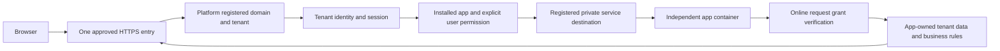

# Platform entry and independent application audit

2026-11-18. This record separates implemented behavior from the broader entry-point handoff. Runtime outcomes belong to the deployment stage records and the work record.

## Required flow

Domain registration resolves the tenant. An explicitly registered app mapping selects the product. Caller-supplied destinations, tenant headers and database headers cannot select authority. Public Ecommerce customer/catalog traffic needs its own explicit contract; staff grants cannot be bypassed by classifying a protected route as public.

## Actual versus required

| Area | Current implementation | Remaining evidence or work |
| --- | --- | --- |
| Container lifecycle | Separate containers, network namespaces, addresses and own loopback ports on applications_backend; CodeShip owns operations | Verified all nine healthy endpoints; Platform replacement preserved all eight app IDs; CRM replacement preserved its eight peers |
| Private calls | Byte-preserving bridges retain the SDK loopback allowlist, Host, Origin and request-grant checks | Exercise real Billing-to-Core user delegation and downstream revocation |
| Identity and API gateway | Platform owns tenant/domain resolution, tenant sessions, explicit access and request-bound grants | Gateway and two tenant identity/runtime PostgreSQL suites passed; 24 existing-account checks passed without password changes. Single-entry browser and cloud acceptance remain pending |
| Frontends | Each app currently serves its own loopback origin and same-origin Platform adapter | Single-entry frontend/assets/SPA/login routing is not implemented by these network bridges |
| Ecommerce | App owns public catalog/customer APIs; staff APIs use Platform | A reviewed public-entry route contract must preserve that separation |
| Data | Independent cloned databases/roles and retained uploads; existing fixed partitions remain fixed | Another tenant requires an explicitly reviewed database/service binding |
| Release identity | Immutable GitHub manifests and exact image content; shell-only CodeShip operation entries | Record actual completed tags and runtime checks |
| Cloud ingress | Local ports are loopback-only; existing transport is explicitly local Docker | Select host, domains, authenticated private execution, TLS/access and off-host recovery before live deployment |

The source native authentication audit is in Platform's auth-gate-rollout.md. It is evidence for those native tests, not proof of cloud ingress or completed local container acceptance. No users, grants or password changes are authorized merely to make verification pass. Destructive and multi-tenant security scenarios use disposable fixtures.

## Runtime boundaries

Platform owns 4453. Core App, Billing, CRM, Ecommerce, HRMS, Automation, Zetro and Texlinks own 4454 through 4461 respectively. Devkits retain 4450 through 4452 in their separate group. PostgreSQL is shared infrastructure with separate app roles/databases. Apps receive neither a Docker socket nor host publishing credentials.

Do not weaken loopback/SSRF checks to accept arbitrary Docker DNS destinations. Platform continues using registered loopback service URLs; reviewed byte bridges provide the private transport without changing request authority. Platform replacement must leave app IDs and persisted data unchanged.
